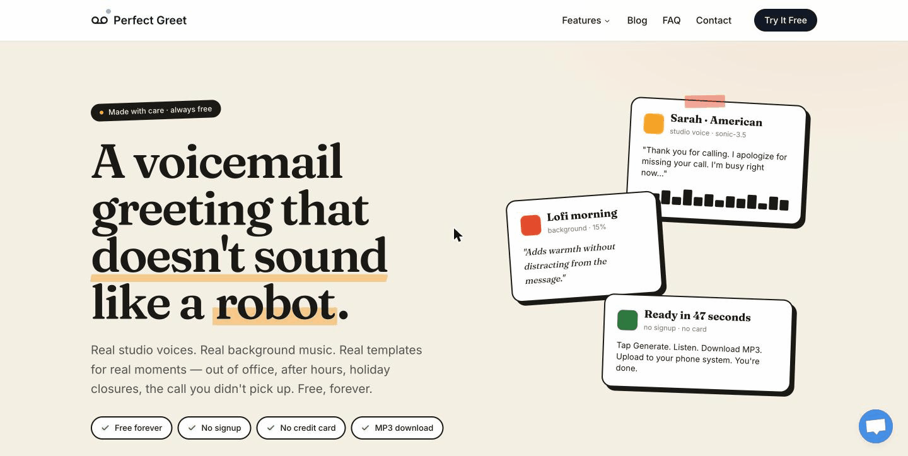
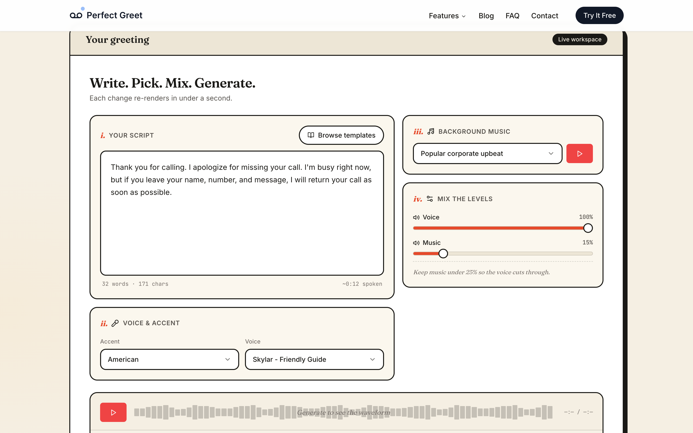
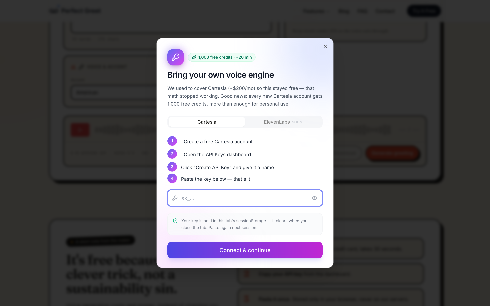

# Speakeasy

**Live demo: [voicemail.ahmed-ibrahim.com](https://voicemail.ahmed-ibrahim.com)**

Free voicemail and on-hold greetings — bring your own Cartesia key, never pay a SaaS bill.

[](LICENSE)
[](https://nextjs.org)
[](https://cartesia.ai)
[](CONTRIBUTING.md)

A self-hostable Next.js app that turns a script and a voice into a finished MP3 — voicemail greetings, hold messages, IVR prompts. No signup, no email gate, no per-minute charges.



## Why this exists

Every "voicemail generator" SaaS charges $10–$20 a month for what is, structurally, a single TTS API call followed by a mix-down. Speakeasy costs nothing to run for visitors because each visitor brings their own Cartesia API key. Cartesia hands out 1,000 free credits per account — roughly 20 minutes of synthesized audio — which is more than enough for a personal greeting or a small business hold loop. The app's job is to make that experience pleasant, not to put a paywall in front of it.

## What you get

- Cartesia **Sonic 3.5** voices (749 in the catalog as of last sync — every accent, every gender, every English locale Cartesia ships)
- **56 royalty-free background tracks**, grouped by Corporate, Lofi, Jazz, Piano, Guitar, and Various
- **10 battle-tested script templates** for voicemail, on-hold, after-hours, and IVR scenarios
- **Client-side audio mixing** via Crunker + the Web Audio API — the server only renders TTS, the browser handles the mix
- **MP3 and WAV export**, no watermark, no attribution required



## Quick start

```bash
git clone https://github.com/AhmadIbrahiim/speakeasy
cd speakeasy
cp .env.example .env   # optional — see Environment variables
npm install
npm run dev            # http://localhost:3000
```

That's it. The voice catalog populates from Cartesia on first load; the BYO-key dialog opens the first time you click Generate.

> Anything under [`scripts/`](scripts/README.md) is **optional content-authoring tooling** for regenerating blog posts and thumbnails. You do not need to run any of it to develop or use the app.

## Bring your own key (BYO)

The whole flow takes about 30 seconds:

1. Sign up at [cartesia.ai](https://cartesia.ai/) (free, no card).
2. Open the [API Keys dashboard](https://play.cartesia.ai/keys).
3. Click **Create API Key**, give it a name.
4. Paste the `sk_...` key into the dialog in the app.



**Storage.** Your key is held in `sessionStorage` on your own browser — it clears the moment you close the tab. Paste it again next session.

**We never see your key.** The browser forwards it on each generate request to the local Next.js API route, which proxies the single Cartesia TTS call and discards the key the moment the request completes. There is no database, no logging of the key, and no key persistence on the server side.

## Architecture

- **Next.js 15 App Router** on **Cloudflare Workers** via [`@opennextjs/cloudflare`](https://opennext.js.org/cloudflare) with a small mix of server and client components.
- **Cartesia TTS** via the official `@cartesia/cartesia-js` SDK.
- **Voice catalog** is cached for 14 days via `src/app/server/lib/VoiceCache.ts` so the picker is instant after the first fetch.
- **Client-side mixing** with `crunker` — the server never composes the music + voice. It only returns the raw TTS clip.
- **R2 cache** (binding `CACHE`) stores rendered audio and the voice catalog. Best-effort: without it the app still works, just uncached.
- **Rate-limited proxy** on `POST /api` — 10 requests per minute per IP via `src/app/server/lib/rateLimit.ts`.
- **Strict allowlist** on `GET /api/background` — only known lowercase `.mp3` basenames are served, blocking any path-traversal attempt.

## Deploy

Production runs on **Cloudflare Workers** at https://voicemail.ahmed-ibrahim.com. Every push to `main` deploys automatically via GitHub Actions. Full steps, first-time setup, and rollback: [DEPLOY.md](DEPLOY.md).

```bash
npm run preview   # build + run the Worker locally (workerd)
npm run deploy    # build + deploy to Cloudflare
```

The `Dockerfile` / `render.yaml` still work for self-hosting (`npm run build && npm start`), minus the R2 cache.

## Environment variables

All three are **optional**. The visitor flow works on a fresh checkout with an empty `.env`.

| Var                      | Required?         | Purpose                                                                                                              |
| ------------------------ | ----------------- | -------------------------------------------------------------------------------------------------------------------- |
| `CARTESIA_API_KEY`       | Optional          | Server-side voice catalog fetch only. Audio generation always uses the visitor's BYO key from the request body.       |
| `ELEVENLABS_API_KEY`     | Optional / unused | Reserved for a future ElevenLabs tab — currently disabled in the UI.                                                  |
| `GEMINI_API_KEY`         | Optional          | Only used by the auxiliary blog-content tooling under `scripts/` (see [`scripts/README.md`](scripts/README.md)). Not needed for the app itself. |

## Security model

- All three secrets above are optional; the visitor flow never requires server-side credentials.
- The visitor's Cartesia key is never persisted server-side. It lives in the browser's `sessionStorage` (cleared when the tab closes) and is forwarded with each generate request only.
- `GET /api/background` is hardened against path traversal with a strict allowlist of lowercase mp3 basenames.
- `POST /api` is rate-limited to 10 requests per minute per IP.
- The Dockerfile runs as a non-root user and exposes a health check at `/api/health`.
- To report a vulnerability, see [SECURITY.md](SECURITY.md).

## Contributing

Issues and pull requests are welcome. Read [CONTRIBUTING.md](CONTRIBUTING.md) for the dev loop, code style, and the review gate before opening a PR.

## License

[MIT](LICENSE). Use it, fork it, ship it — attribution appreciated but not required.

## Acknowledgements

- **[Cartesia](https://cartesia.ai)** — the TTS provider. Not affiliated.
- **[Crunker](https://github.com/jackedgson/crunker)** — browser audio mixing without server round-trips.
- **[shadcn/ui](https://ui.shadcn.com)** — the component primitives this UI is built on.
- **[lucide-react](https://lucide.dev)** — iconography.
- **[Tailwind CSS](https://tailwindcss.com)**, **[Next.js](https://nextjs.org)**, **[React Query](https://tanstack.com/query)** — the rest of the stack.
